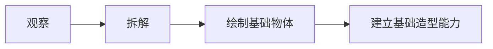

# 上课 2026-10-02 · 插画创意（一对一） · 阶段 1 基础造型 · 第 3 课

> 状态：已完成

## 预习

### 预习脉络图

来源：[插画创意课程大纲](../../1-courses/illustration-creative.md) 中的阶段 1 学习目标。

图中顺序按大纲目标原文展开，只概括阶段目标，不代表第 3 课的教学步骤。课程大纲没有记录本课具体课题、物体、练习内容或教学步骤，不作推测。

### 速览表

| 项目 | 已知信息 | 来源与边界 |
| --- | --- | --- |
| 日期与课程 | 2026-10-02；插画创意（一对一） | 用户批准的本次安排；课程 id 为 `illustration-creative` |
| 上课安排 | 10:00；90 分钟 | 用户批准的本次安排；时长同步记录在 frontmatter |
| 本次主题 | 阶段 1 基础造型 · 第 3 课 | 用户批准的主题表述；课程大纲未提供更具体的课次主题 |
| 阶段目标 | 观察、拆解并绘制基础物体，建立基础造型能力 | [课程大纲](../../1-courses/illustration-creative.md) 原文，仅为阶段目标 |
| 技能 | `foundation/form`，当前级别 L0 | [技能树](../../skill-tree.md)；未调整级别 |
| 相关历史 | 未发现该课程的前次 session 或相关笔记 | 当前 session 目录原先不存在；notes 目录中没有相关课次材料 |
| 作业与 DDL | 未发现可关联的 assignment；不填写作业或 due | `painter-context/4-assignments/` 当前只有 README，没有 assignment 记录 |

### 对照

- 命中：实际主题为窗边植物角，学习了有机型画法、疏密、深衬浅、浅衬深，以及叶片的圆、尖、不规则形状和大小变化。
- 超预期：课下要求丰富画面，主要添加线条和效果。

## 课堂内容

- 主题：窗边植物角。
- 学习有机型画法，关注画面中的疏密关系、深衬浅与浅衬深。
- 叶子可概括为圆、尖、不规则等形状，并注意叶片大小的变化。
- 课下丰富画面，主要添加线条和效果。

## 疑问

## 收获

- 学会用有机型画法表现窗边植物角中的植物形态。
- 开始关注疏密、深衬浅、浅衬深，以及叶片形状和大小对画面丰富度的作用。