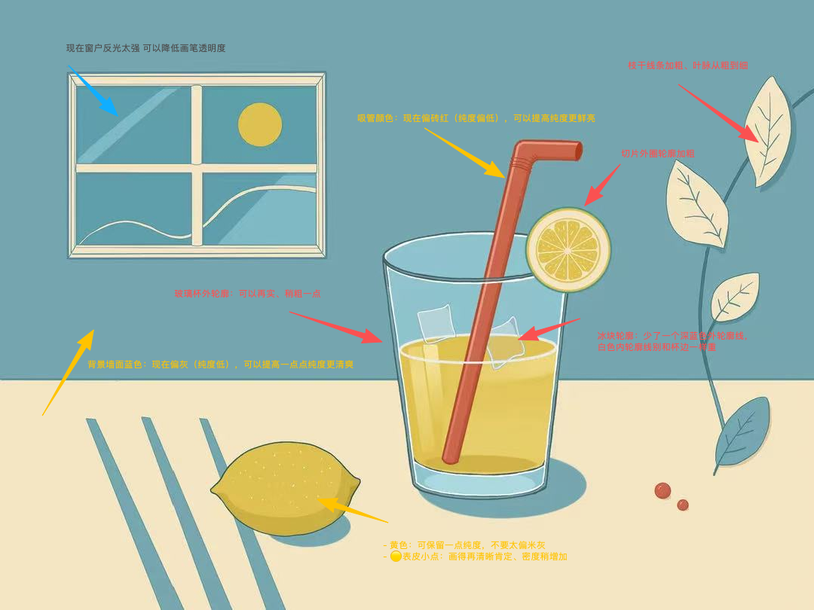

# 夏日柠檬饮色彩作业

## 要求

在课堂完成大色块画面的基础上，模仿细化线稿进行刻画。

## 交付物

夏日柠檬饮的精细线稿与刻画已完成，包括玻璃杯、饮料、吸管、高光与阴影表现。

关联课次：[2026-10-10 夏日柠檬饮色彩基础](../../3-sessions/illustration-creative/2026-10-10-summer-lemon-drink-color-basics.md)。

## 变更记录

## 老师点评

> 来源：用户提供的聊天资料，按要点整理，非逐字引文。

### 老师反馈

- 老师肯定画面元素已画齐，并提醒记得添加投影。
- 线条整体偏细，粗细变化不明显；投影和小细节还可以微调。
- 老师表示下节课会在画面上标注并详细讲解。

### 学生待确认问题

以下问题仍待老师在下节课标注核实，不是老师已确认的结论：

- 窗与柠檬片的投影是否缺失？
- 叶子的投影是否太小？
- 窗与杯子的外轮廓虽有意识加粗，效果是否仍不明显？

### 追加反馈（2026-10-17）

#### 老师反馈

- 线条节奏：主体玻璃杯、柠檬和吸管的外轮廓稍实、稍粗；窗框、枝叶、叶脉、冰块等次要与内部线条收细，避免线条粗细过于平均。
- 明度与纯度：吸管红、背景蓝、果汁黄保留纯度；变暗不等于变灰，变亮不等于鲜艳。
- 小细节加强：柠檬表皮点、切片纹路和叶脉画得更肯定、更清晰。
- Procreate 色盘操作：左右调纯度，上下调明度。
- 本次颜色来自上节课范画色卡，与课后范画不同而造成困惑；老师确认色调不用改，优先加重物体轮廓线。

#### 学生计划与待验证事项

- 学生计划于当天修改上述线条、颜色和细节。
- “明天讲明度/纯度”是老师预告的待后续课程验证事项，不是本次已经发生的课程内容。